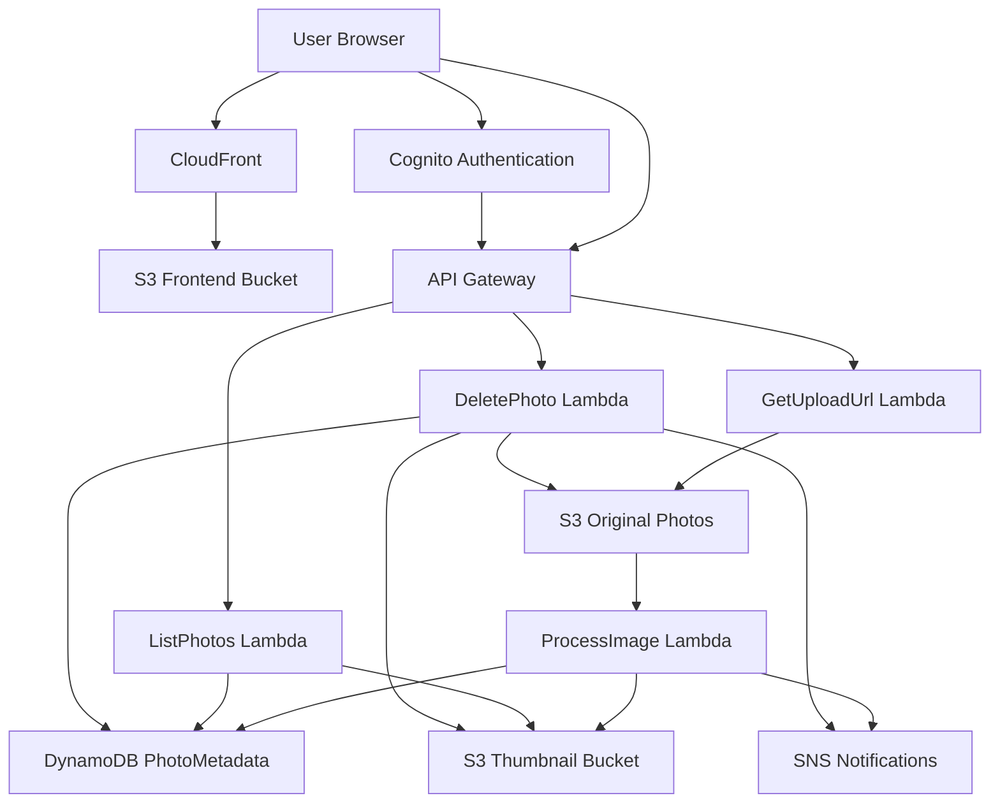
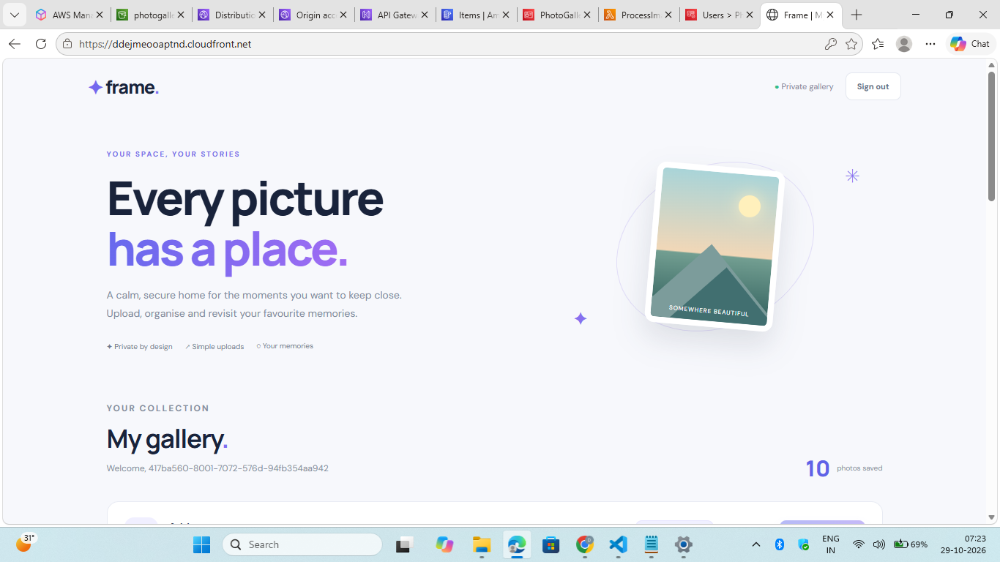
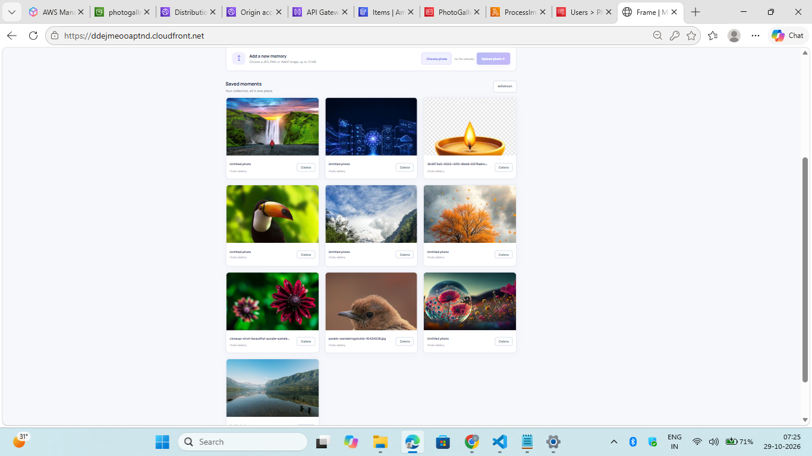
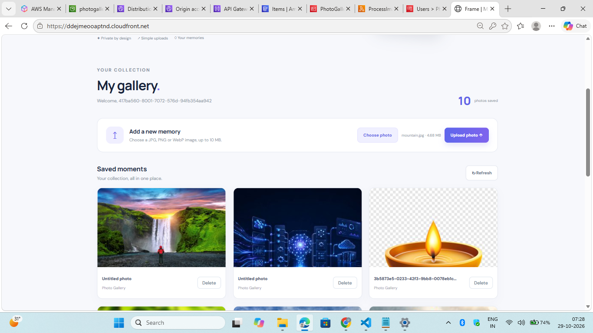
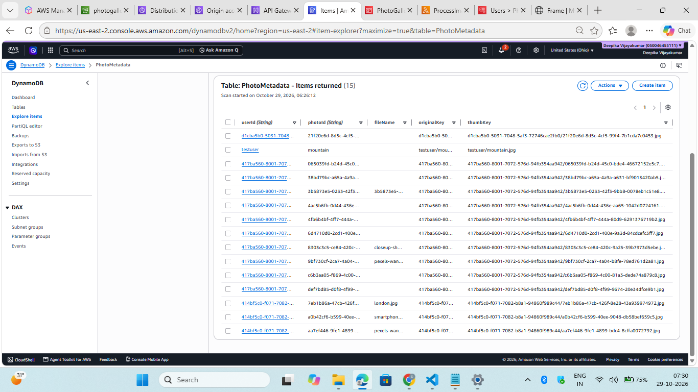
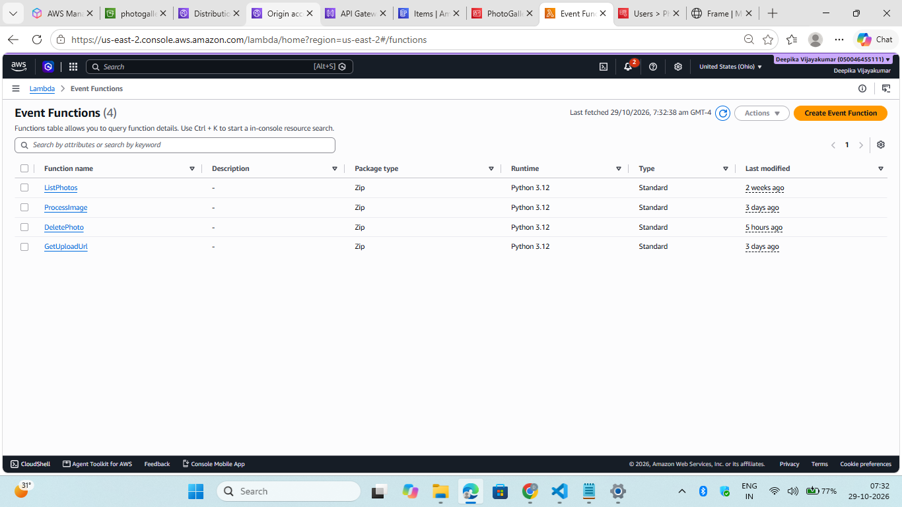
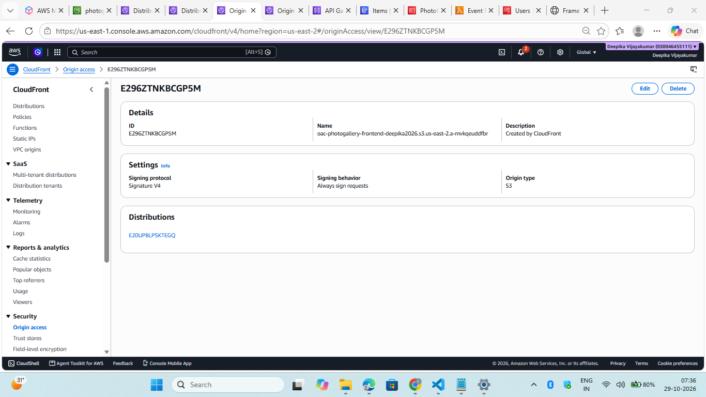

# AWS Serverless Photo Gallery

**A secure, serverless photo gallery application built using Amazon Web Services.**

[Live Application](https://ddejmeooaptnd.cloudfront.net/) | [GitHub Repository](https://github.com/deepikacloud-learner/aws-serverless-photo-gallery)

## 1. Project Overview

The AWS Serverless Photo Gallery is a cloud-based web application that allows users to register, sign in, upload photographs, view their personal gallery and delete uploaded photos.

The application uses AWS managed and serverless services to provide authentication, image storage, image processing, metadata management and email notifications without maintaining traditional application servers.

## 2. Project Objectives

- Build a photo gallery application using AWS services.
- Implement user registration and authentication.
- Enable secure photo uploads using pre-signed S3 URLs.
- Generate image thumbnails automatically.
- Store photo metadata in DynamoDB.
- Provide user-specific photo listing and deletion.
- Send email notifications for photo uploads and deletions.
- Host the frontend through Amazon CloudFront.

## 3. AWS Services Used

| Service | Implementation |
|---|---|
| Amazon S3 | Separate buckets for frontend, original photos and thumbnails |
| Amazon CloudFront | Frontend delivery using Origin Access Control |
| Amazon Cognito | User registration, sign-in and authentication |
| Amazon API Gateway | HTTP API for upload, listing and deletion operations |
| AWS Lambda | Upload URL generation, image processing, listing and deletion |
| Amazon DynamoDB | Photo metadata storage |
| Amazon SNS | Upload and deletion email notifications |
| Amazon CloudWatch | Lambda execution logs and troubleshooting |
| AWS IAM | Permissions for AWS resource access |

## 4. System Architecture

## 5. Application Workflow

### User Authentication
Amazon Cognito manages user registration, account confirmation and sign-in.

Authenticated users access protected API operations through the configured Cognito authorizer.

### Photo Upload
1. The user selects a photo.
2. The frontend requests an upload URL through `POST /upload-url`.
3. API Gateway invokes the GetUploadUrl Lambda function.
4. Lambda generates a pre-signed S3 upload URL.
5. The frontend uploads the photo to the original-photo S3 bucket.
6. The uploaded image is processed asynchronously through an Amazon S3 event notification.

### Image Processing
1. An upload event from the original-photo S3 bucket triggers the ProcessImage Lambda function.
2. Lambda processes the uploaded image and generates a thumbnail.
3. The thumbnail is stored in the thumbnail S3 bucket.
4. Photo metadata is stored in DynamoDB.
5. SNS sends an upload notification email.

### Gallery Display
1. The frontend calls `GET /photos`.
2. API Gateway invokes ListPhotos Lambda.
3. Lambda retrieves metadata belonging to the authenticated user.
4. The application displays the user's photos using thumbnail URLs.

### Photo Deletion
1. The user requests deletion through `DELETE /photos`.
2. DeletePhoto Lambda verifies the authenticated user's photo ownership.
3. The corresponding original photo, thumbnail and metadata record are deleted.
4. SNS sends a deletion notification email.

## 6. API Endpoints

| Method | Endpoint | Purpose |
|---|---|---|
| POST | `/upload-url` | Generate a photo upload URL |
| GET | `/photos` | Retrieve the authenticated user's photos |
| DELETE | `/photos` | Delete a selected photo |

The API routes are configured with Cognito authorization.

## 7. Security Implementation

- Cognito authentication for application users.
- Cognito authorization on protected API routes.
- User-specific photo records and S3 object key prefixes.
- Ownership checks before photo deletion.
- S3 Block Public Access enabled on the original-photo and thumbnail buckets.
- CloudFront Origin Access Control for private frontend S3 access.
- IAM execution roles and permissions configured to allow Lambda functions to access the required AWS services.

## 8. Testing and Results

The following features were tested in the deployed application:

| Test | Result |
|---|---|
| User registration and sign-in | Successful |
| Photo upload | Successful |
| Thumbnail generation | Successful |
| Gallery display | Successful |
| User-specific photo listing | Successful |
| Photo deletion | Successful |
| Upload email notification | Successful |
| Delete email notification | Successful |
| CloudFront website access | Successful |

## 9. Project Challenges and Learning

During implementation, I worked through:

- Cognito authentication and API authorization configuration.
- API Gateway and Lambda integration.
- IAM execution-role and permission issues.
- S3 upload and thumbnail storage configuration.
- Lambda image processing and DynamoDB integration.
- CloudFront and S3 Origin Access Control configuration.
- Debugging using Amazon CloudWatch logs.
- Testing user-specific access and photo deletion.

## 10. Future Enhancements

- Photo search and filtering.
- Photo albums and categories.
- Improved image processing.
- Additional monitoring and performance analytics.
- Enhanced application security and access controls.

## 11. Project Screenshots

### Login

### Photo Gallery

### Photo Upload

### DynamoDB Metadata

### Lambda Functions

### CloudFront and S3

## 12. Project Links

- **Live Application:** https://ddejmeooaptnd.cloudfront.net/
- **GitHub Repository:** https://github.com/deepikacloud-learner/aws-serverless-photo-gallery

## Author

**Deepika Vijayakumar**

AWS Certified Solutions Architect – Associate

GitHub: https://github.com/deepikacloud-learner

*Developed as a hands-on AWS serverless cloud portfolio project.*
